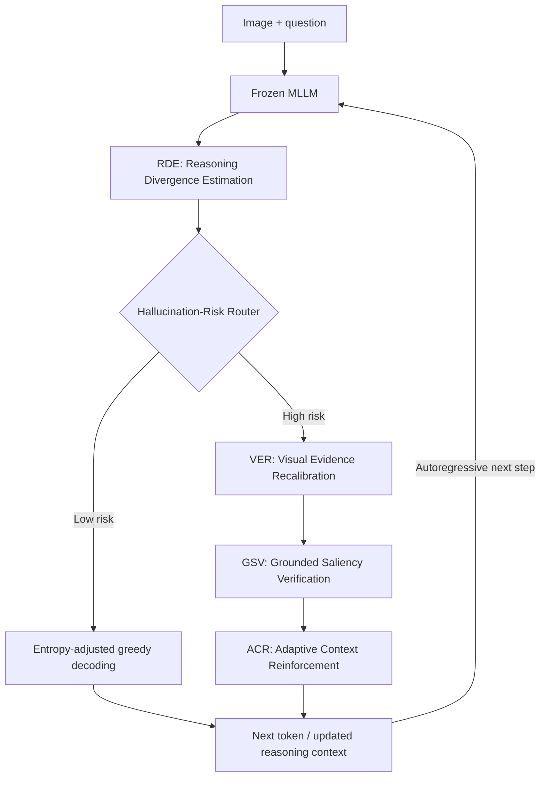

# RACER: Reasoning-Aware Coherence and Evidence Recalibration

**Training-Free Hallucination Mitigation in Multimodal Reasoning**

RACER is a training-free inference framework designed to reduce hallucination during **multimodal chain-of-thought reasoning and final-answer generation**. Rather than applying the same correction to every token, RACER estimates the reliability of each decoding step and selectively recalibrates visual evidence, verifies candidate tokens, and reinforces useful reasoning context.

The framework operates on **frozen multimodal large language models (MLLMs)**: no fine-tuning, additional trainable modules, or parameter updates are required. The current implementation targets **Qwen2.5-VL-compatible architectures**, including the GRIT reasoning model used in the experiments.

## Overview

A grounding error that emerges within an intermediate reasoning step can influence later generated tokens, even when the resulting answer appears linguistically coherent. RACER treats hallucination mitigation as a **reasoning–evidence–coherence control problem**, with three complementary goals:

1. **Identify unreliable reasoning states:** estimate whether candidate predictions receive concentrated visual support.
2. **Recalibrate visual evidence when necessary:** retrieve relevant visual representations rather than indiscriminately modifying every decoding state.
3. **Verify and preserve grounded generation:** check candidate dependency on both the image and the preceding reasoning context, then reinforce informative dependencies at subsequent steps.

### Risk-adaptive inference



At each step, the router uses a risk estimate derived from visual uncertainty, prior-token grounding saliency, and model confidence. High-risk steps receive stronger correction; low-risk steps retain a lighter inference path. The diagram summarizes the intended procedure; the current code implements it with inference-time activation, logit, attention, and candidate-selection operations.

## Main methodological contributions

### 1. Reasoning Divergence Estimation (RDE)

RDE measures candidate-aware visual-support uncertainty across multiple decoder layers. It projects visual-token representations into vocabulary space, estimates spatial entropy for each candidate, and aggregates entropy over the current Top-K candidate distribution. A continuous gate and reasoning/answer phase scaling determine the strength of the logit adjustment.

**Distinctive elements:** multi-layer visual entropy, candidate-expected uncertainty, smooth gating, and phase-aware correction.

### 2. Visual Evidence Recalibration (VER)

VER maintains an image-conditioned representation direction and retrieves step-relevant visual context from cached visual reference representations. It prioritizes informative visual positions using attention, keeps the retrieval and fusion representations in a consistent space, and activates stronger retracing selectively through the risk router.

**Distinctive elements:** decode-only visual steering, attention-prioritized reference memory, MLP-space visual retrieval, relevance-aware gating, and routed retracing.

### 3. Grounded Saliency Verification (GSV)

GSV evaluates candidate tokens using gradient-weighted attention to **both previously generated context and visual input positions**. It normalizes these signals with recent saliency statistics, uses visual uncertainty to set candidate-specific acceptance thresholds, and provides a probability–saliency calibrated fallback when the candidate pool is exhausted.

**Distinctive elements:** joint visual/textual grounding, uncertainty-aware verification, and confidence-sensitive fallback.

### 4. Adaptive Context Reinforcement (ACR)

ACR increases attention toward recent generated tokens when contextual grounding weakens. It also maintains attention toward informative visual anchors, reducing the likelihood that later reasoning steps drift away from image-supported evidence.

**Distinctive elements:** saliency-adaptive local reinforcement and visual-anchor attention bias.

### 5. Hallucination-Risk Router

The router coordinates these operations using a token-level risk score:

$$
r_t = w_E g_t^E + w_S g_t^S + w_C (1-p_t^{\max})
$$

where $g_t^E$ is visual uncertainty, $g_t^S$ measures a decline in grounding saliency, and $p_t^{\max}$ is the model's maximum next-token confidence. Available terms are weight-normalized when a signal is missing.

- **Low risk:** decode directly from the RDE-adjusted distribution.
- **High risk:** enable stronger visual-context retracing, perform grounded candidate verification when required, and adapt contextual reinforcement for the following step.

The central contribution is the **coupling of reliability estimation with the inference decision**, so both the location and intensity of intervention depend on the evolving reasoning trajectory.

## Repository layout

| File or directory | Purpose |
|---|---|
| `generate_chair_all.py` | Main autoregressive generation and intervention loop |
| `mcot_plus.py` / `src/mcot_plus.py` | RDE: visual-entropy estimation and candidate-aware logit adjustment |
| `ott_qwen.py` / `src/ott_qwen.py` | VER: visual steering, reference selection, and retracing |
| `saliency_qwen.py` / `src/saliency_qwen.py` | GSV and ACR: candidate verification and attention reinforcement |
| `risk_router.py` / `src/risk_router.py` | Token-level hallucination-risk estimation and routing |
| `run_mcot_ott_saliency.sh` | Main generation runner (legacy filename) |
| `run_ablation_matrix.sh` | Component and control ablations |
| `evaluate_all_chair.sh` | Object HalBench/CHAIR evaluation wrapper |
| `tests/` | Implementation and regression tests |

**Implementation note:** Some filenames and command-line switches retain historical names for backward compatibility. The scientific component names used in the paper are **RDE, VER, GSV, ACR, and Hallucination-Risk Router**.

## Installation

### Requirements

- Python environment compatible with the Qwen2.5-VL model family.
- A CUDA-capable GPU with sufficient memory for the selected checkpoint and gradient-based verification.
- COCO images and associated annotations/cache for Object HalBench evaluation.
- Model weights for the selected supported checkpoint.

The current code was developed with `transformers==4.49.0`, `huggingface-hub>=0.26.0,<1.0`, and `accelerate>=1.0.1` (see `requirements-overlay.txt`). Additional dependencies come from the model and benchmark host environment.

### Current installation workflow

**The current public release is deployed into a compatible host evaluation environment; it is not yet a fully self-contained installer.** The target directory must contain compatible `generate_chair.py` and `chair.py` entry points.

```bash
git clone https://github.com/Omid-Nejati/RACER.git
cd RACER

# Copy RACER inference and evaluation scripts to the supported host checkout.
bash scripts/install_into_mcot.sh /path/to/host-checkout

cd /path/to/host-checkout
source /path/to/your/venv/bin/activate
python check_all_env.py
python -m pip check
```

The installation helper retains the host's original generation and CHAIR evaluation files.

## Run RACER

Set paths appropriate for your system, and explicitly choose the **`ours` preset** to activate the RACER method:

```bash
export MODEL_ID='yfan1997/GRIT-20-Qwen2.5-VL-3B'
export IMAGE_ROOT='/path/to/coco/val2014'
export INPUT='coco_images.json'
export GPU=0
export PRESET=ours
export METHODS='mcot,ott,sgrs,locore'
export SEED=1994
export NUM_SAMPLES=2
export MAX_NEW_TOKENS=64
export OUTPUT='results/racer_smoke.json'

bash run_mcot_ott_saliency.sh
```

The `METHODS` switch uses backward-compatible implementation identifiers. **`PRESET=ours` is important:** the current runner's default is `port`, a separate legacy reference configuration, not the proposed RACER setting.

For a larger Object HalBench generation run, change `NUM_SAMPLES` and `MAX_NEW_TOKENS` after confirming the smoke test works. Ensure `coco_images.json` contains the intended sample records and `IMAGE_ROOT` points to the corresponding image directory.

## Evaluation

To compute CHAIR metrics from a generated predictions file:

```bash
bash evaluate_all_chair.sh results/racer_smoke.json
```

The evaluation script uses the host's `chair.py` and `chair.pkl` files. Keep datasets, prompts, seeds, generation budgets, and model checkpoints fixed when comparing methods.

## Ablations and reproducibility

The repository includes configurable variants of visual-entropy estimation, visual-reference selection, candidate verification, local reinforcement, and routing. For a small preliminary ablation run:

```bash
export IMAGE_ROOT='/path/to/coco/val2014'
export NUM_SAMPLES=10
TABLE=b bash run_ablation_matrix.sh
```

`TABLE=b` selects the existing RACER component-ablation matrix. **Verify the exact behavior of each switch and regenerate benchmark metrics before using results in a paper.** In particular, `--router always` changes the correction policy and should be evaluated in conjunction with its visual-retracing configuration when interpreting the no-router comparison.

The generation output includes diagnostics such as per-token risk estimates, visual-entropy gates, saliency-verification decisions, retracing steps, and execution-time counters. These can be used to analyze *when* RACER intervenes and the cost of those interventions.

### Selected hyperparameters (current RACER preset)

| Parameter | Value |
|---|---|
| RDE entropy layers | `-1,-6,-12` |
| RDE candidate set / threshold / gate temperature | `5` / `0.5` / `0.05` |
| RDE base adjustment strength | `0.75` |
| VER steering coefficient / retrieval ratio | `0.1111` / `0.06` |
| Visual reference limit | `128` |
| GSV candidate set / max rejection attempts | `5` / `3` |
| GSV visual-saliency weight / entropy coupling | `0.3` / `0.5` |
| ACR base / maximum local reinforcement | `0.20` / `0.60` |
| ACR visual-anchor strength / anchor count | `0.10` / `32` |
| Risk weights (entropy / saliency / confidence) | `0.5` / `0.3` / `0.2` |
| Risk threshold / verification confidence skip | `0.5` / `0.95` |

### Reproducibility considerations

- Grounded saliency uses model-internal attention gradients, so output-only inference APIs are insufficient.
- Gradient-based candidate verification increases inference time and memory use; benchmark hardware should be reported.
- The current implementation is Qwen2.5-VL-specific in parts. Applying it to a different MLLM architecture requires validating hooks, visual-token indexing, and phase detection.
- Report results only after running the complete method and baselines under a consistent evaluation protocol.

## References and acknowledgments

The repository implements and evaluates inference-time visual-entropy control, representation-level visual retracing, and gradient-based contextual verification in a unified research setting. We acknowledge the prior work relevant to these operations:

1. **MCoT:**   [Code](https://github.com/ASGO-MM/MCoT-hallucination)
2. **OTT:**  [Code](https://github.com/Fazhan-cs/OTT)
3. **LVLMs-Saliency:**  [Paper](https://arxiv.org/abs/2601.20279) · [Code](https://github.com/zhangbaijin/LVLMs-Saliency)

Please also respect the licenses and attribution requirements of upstream software used by the installation workflow.

## Citation

If you use RACER in your research, please cite the accompanying paper once its official preprint or proceedings record is available:

> **RACER: Reasoning-Aware Coherence and Evidence Recalibration for Hallucination Mitigation in Multimodal Reasoning.**

## Contact

For implementation questions and research discussions, open an issue in this repository.
